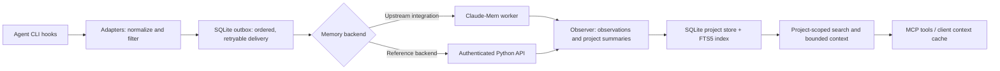

# Mnemosyne

A persistent project-memory bridge for coding agents. Mnemosyne captures supported CLI events, queues them durably, and makes project-scoped context available across sessions.

**Stack:** Python 3.11+, SQLite/FTS5, FastAPI, Pydantic, HTTPX, and the Model Context Protocol (MCP).

## Memory lifecycle



Capture is separated from delivery: client adapters normalize supported hook formats, filter recognized sensitive payloads, and append events to a local SQLite outbox. A background sender retries delivery while preserving per-session order. The selected backend processes events into observations, evidence-linked milestones, and versioned project summaries. Recall uses SQLite FTS5 ranking and token-bounded responses, then exposes results through MCP tools or the client context cache.

The upstream path uses [Claude-Mem](https://github.com/thedotmack/claude-mem) for its worker and observation pipeline. `server/` is an independent Python reference backend. The current implementation does **not** include vector embeddings, cosine-similarity search, or an automatic memory-decay pipeline; search is full-text (FTS5), and project summaries are versioned.

## Quickstart

Requires Python 3.11 or newer. In PowerShell, run these three command lines from the repository root:

```powershell
python -m venv .venv
.venv/Scripts/python.exe -m pip install -r requirements.lock; .venv/Scripts/python.exe -m pip install --no-deps -e .
.venv/Scripts/python.exe -m bridge.cli --help
```

On Linux or macOS, use `.venv/bin/python` in place of `.venv/Scripts/python.exe`.

To start the local reference API, create credentials with `python examples/create_credentials.py`, set `HERMES_MEMORY_CREDENTIALS` and `HERMES_MEMORY_DB`, then run `python -m server.api`. The API listens on `127.0.0.1:8787`; project and memory routes require a bearer credential.

## Architecture and module boundaries

| Module | Responsibility |
| --- | --- |
| `bridge/adapters/` | Normalize supported client hook payloads and apply filtering. |
| `bridge/outbox.py` | Durable local queue, duplicate handling, ordering, and retry state. |
| `bridge/upstream_transport.py` | Deliver and query the upstream Claude-Mem integration. |
| `bridge/identity.py`, `bridge/discovery.py` | Resolve projects from explicit bindings and workspace metadata. |
| `bridge/cache.py` | Cache and bound context injected into client sessions. |
| `bridge/cli.py` | Installation, diagnostics, and bridge commands. |
| `server/db.py`, `server/migrations/` | SQLite schema, transactional ingestion, registry, and evidence storage. |
| `server/observer.py`, `server/maintenance.py` | Event processing, summary versions, milestone evidence, and maintenance. |
| `server/retrieval.py` | FTS5 search, timelines, and token-bounded context. |
| `server/api.py`, `server/mcp_server.py` | Authenticated HTTP API and MCP interface. |

## Local retrieval benchmark

A synthetic FTS5 smoke benchmark on Windows with Python 3.13 indexed 10,000 observations. Across 60 repeated warm-cache searches through `search_memories`, median latency was **1.65 ms** and p95 was **2.25 ms**. The SQLite database occupied **4.0 MiB** after checkpointing. This is on one local machine and a synthetic corpus; database size is disk footprint, not process RAM. It is not a vector-search or production workload benchmark.

The benchmark corpus and method are described here so results are not mistaken for a general performance guarantee. Re-run under your target hardware and workload before comparing systems.

## Tests

```bash
python -m pytest -q
```

The suite covers capture, delivery failures, concurrency, project identity, retrieval, authentication, and payload filtering. Client-native hook dispatch and remote model processing need separate end-to-end verification.

## Limitations

- Secret filtering is pattern-based; prompts, outputs, and local storage may still contain sensitive information.
- The reference API is designed for a single-user deployment.
- Backup and restore utilities have known defects: backup verification omits `user_prompts`; restore-test cleanup can delete an existing target; and shell restore can misclassify similarly prefixed test/live paths. Do not use these utilities with valuable data until corrected.

This project integrates with Claude-Mem and Hermes Agent, which retain their own authorship and licenses.
