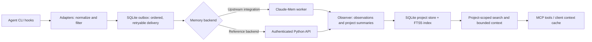

# Mnemosyne

A persistent project-memory bridge for coding agents. Mnemosyne captures supported CLI events, queues them durably, and makes project-scoped context available across sessions.

When a coding session ends, its decisions and unfinished work should remain available to the next session. The bridge handles capture and reliable delivery; project-scoped recall returns relevant observations and compact summaries.

**Stack:** Python 3.11+, SQLite/FTS5, FastAPI, Pydantic, HTTPX, and the Model Context Protocol (MCP).

## Memory lifecycle



Capture is separated from delivery: client adapters normalize supported hook formats, filter recognized sensitive payloads, and append events to a local SQLite outbox. A background sender retries delivery while preserving per-session order. The selected backend processes events into observations, evidence-linked milestones, and versioned project summaries. Recall uses SQLite FTS5 ranking and token-bounded responses, then exposes results through MCP tools or the client context cache.

The upstream path uses [Claude-Mem](https://github.com/thedotmack/claude-mem) for its worker and observation pipeline. `server/` is an independent Python reference backend. The current implementation does **not** include vector embeddings, cosine-similarity search, or an automatic memory-decay pipeline; search is full-text (FTS5), and project summaries are versioned.

## What this repository implements

The project-specific code includes the client adapters, durable outbox, project identity and discovery, context cache, and upstream transport in `bridge/`. The independent `server/` reference implementation provides authenticated ingestion, SQLite storage, observation processing, versioned summaries, FTS5 retrieval, and an MCP interface.

The integrated upstream worker and its observation pipeline come from [Claude-Mem](https://github.com/thedotmack/claude-mem). [Hermes Agent](https://github.com/NousResearch/hermes-agent) supplies the agent runtime used by the integration. These are upstream projects with their own authorship and licenses.

## Quickstart

Requires Python 3.11 or newer. In PowerShell, run these three command lines from the repository root:

```powershell
python -m venv .venv
.venv/Scripts/python.exe -m pip install -r requirements.lock; .venv/Scripts/python.exe -m pip install --no-deps -e .
.venv/Scripts/python.exe -m examples.local_recall
```

The demo queues a sample decision, ingests it into the reference backend, processes it with the built-in rule-based extractor, then reopens the database and searches for `SQLite`. It prints `Ingestion: accepted`, the observation count, and the recalled decision. It runs offline using temporary databases; no API keys or agent-hook installation are needed. This demonstrates local persistence and retrieval; native hook dispatch and upstream delivery are separate integration steps.

On Linux or macOS, use `.venv/bin/python` in place of `.venv/Scripts/python.exe`.

To inspect bridge commands, run `.venv/Scripts/python.exe -m bridge.cli --help`.

To start the local reference API in PowerShell:

```powershell
.venv/Scripts/python.exe examples/create_credentials.py
$env:HERMES_MEMORY_CREDENTIALS = "credentials.local.json"
$env:HERMES_MEMORY_DB = "memory.local.db"
.venv/Scripts/python.exe -m server.api
```

The API listens on `127.0.0.1:8787`; project and memory routes require a bearer credential. The credential generator writes the token to `admin-token.local.txt` and its hash to `credentials.local.json`; both files and the database are ignored by Git. It refuses to overwrite existing credentials.

## Architecture and module boundaries

| Module | Responsibility |
| --- | --- |
| `bridge/adapters/` | Normalize supported client hook payloads and apply filtering. |
| `bridge/outbox.py` | Durable local queue, duplicate handling, ordering, and retry state. |
| `bridge/upstream_transport.py` | Deliver and query the upstream Claude-Mem integration. |
| `bridge/identity.py`, `bridge/discovery.py` | Resolve projects from explicit bindings and workspace metadata. |
| `bridge/cache.py` | Cache and bound context injected into client sessions. |
| `bridge/cli.py` | Installation, diagnostics, and bridge commands. |
| `server/db.py`, `server/migrations/` | SQLite schema, transactional ingestion, registry, and evidence storage. |
| `server/observer.py`, `server/maintenance.py` | Event processing, summary versions, milestone evidence, and maintenance. |
| `server/retrieval.py` | FTS5 search, timelines, and token-bounded context. |
| `server/api.py`, `server/mcp_server.py` | Authenticated HTTP API and MCP interface. |

## Local retrieval benchmark

Run the included benchmark after installing dependencies:

```powershell
.venv/Scripts/python.exe -m benchmarks.retrieval_benchmark --records 10000 --queries 60
```

The script creates a temporary SQLite database with 10,000 deterministic observations and their FTS5 index. It performs 10 warmup searches, then measures 60 repeated calls to `search_memories` for `topic0`, with a five-result limit and a 1,000-token estimated response budget. Timing includes connection setup, FTS5/BM25 ranking, and response construction; corpus creation and observation extraction are excluded.

Example measured run on Windows 11, Python 3.12.13, SQLite 3.50.4, and an Intel Family 6 / Model 186 processor:

| Measurement | Result |
| --- | ---: |
| Observations indexed | 10,000 |
| Median retrieval latency | 2.48 ms |
| p95 retrieval latency | 3.09 ms |
| Checkpointed database size | 5.31 MiB |

These measurements replace the earlier ad hoc smoke-benchmark figures with results from the included script.

Output includes median and p95 latency, Python/SQLite versions, platform and processor details, and checkpointed database size. Database size measures disk usage, not process RAM. This is a synthetic warm-cache reference-backend benchmark; results depend on hardware, corpus, and query selectivity.

## Tests

```bash
python -m pytest -q
```

The suite covers capture, delivery failures, concurrency, project identity, retrieval, authentication, and payload filtering. Client-native hook dispatch and remote model processing need separate end-to-end verification.

## Limitations

- Secret filtering is pattern-based; prompts, outputs, and local storage may still contain sensitive information.
- The reference API is designed for a single-user deployment.
- Backup and restore utilities have known defects: backup verification omits `user_prompts`; restore-test cleanup can delete an existing target; and shell restore can misclassify similarly prefixed test/live paths. Do not use these utilities with valuable data until corrected.

This project integrates with Claude-Mem and Hermes Agent, which retain their own authorship and licenses.
